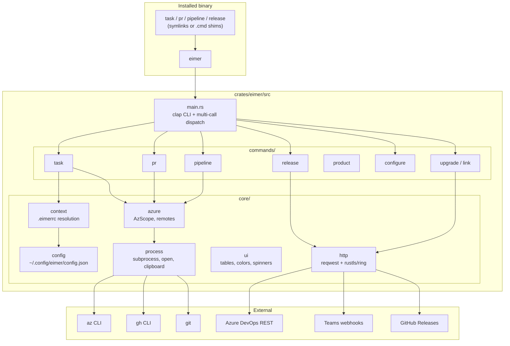

# Architecture

## Overview
`eimer` is a single Rust binary (`crates/eimer`) with command groups for tasks, pull requests, pipelines and releases. All Azure DevOps interaction for tasks, PRs and pipelines is delegated to the `az` CLI via subprocesses; GitHub PRs use `gh`; the release commands call the Azure DevOps REST API directly (so they work in CI without `az`).

The TypeScript release CLI (`packages/release`) remains in the repo because it is published as `@tapio/release` to Azure Artifacts and run via `bunx` in company pipelines. `packages/ui` is its only workspace dependency; `packages/helpers` holds standalone scripts outside the CLI.

## System Diagram

## Components

### `main.rs`: CLI entry
- clap derive definition of all command groups (`task`, `pr`, `pipeline`, `release`, `configure`, `upgrade`, `link`)
- Multi-call: if invoked as `task`, `pr`, `pipeline` or `release` (symlink or `.cmd` shim), it behaves like `eimer <name>`
- Errors bubble up as `anyhow::Error`; `core::error::report` prints them (with the innermost hint) and sets the exit code

### `commands/task`
- Work items via `az boards`, scoped by the active context (`--context` > `EIMER_CONTEXT` > nearest `.eimerrc` > `defaultContext`, else `--detect true`)
- `list mine|team|children` (bare `list` = `mine`), `create`, `recent`, `start`, `close`, `show`, `context show|list|use`
- See [feature 007](features/007-task-contexts-and-az-style-commands.md)

### `commands/pr`
- Azure DevOps (`az repos pr`, threads via REST with the `az` access token) and GitHub (`gh`)
- `create`, `comments`, `copy`, `list`, `open`, `show`

### `commands/pipeline`
- `az pipelines` runs/list/open/show/trigger/watch, filtered to the current repo

### `commands/release`
- `changelog` (commit range between production releases, grouped conventional commits, Teams posting), `approve`, `configure`
- Config at `~/.config/tapio-release/config.json`, shared with the TS `@tapio/release`
- Auth: `SYSTEM_ACCESSTOKEN` > `AZURE_DEVOPS_PAT` > `az`; context: `SYSTEM_COLLECTIONURI` + `SYSTEM_TEAMPROJECT` > `az devops configure` > git remote

### `commands/product`
- `init`, `status`, `update`, `check`: update posts from Changesets changelogs, configured per repo in `.eimer/product.json`
- Pure core (changelog parser, front-matter subset, globs, coverage) with unit tests; git lookups behind the `changes::Git` trait
- Hands work to a coding agent via a rendered prompt (built-in `default_prompt.md` or the repo's `promptTemplate`)
- See [feature 009](features/009-product-updates.md)

### `commands/upgrade`
- `upgrade [--check] [--to <version>] [--force]`: finds the newest `eimer/v*` GitHub Release, downloads the asset for the current platform, verifies its `.sha256`, replaces itself (`self-replace`)
- `link [--dir] [--remove]`: creates the multi-call symlinks (`.cmd` shims on Windows)

### `core/`
- `config`: typed `config.json` with unknown keys preserved on save
- `context`: `.eimerrc` discovery and precedence (pure `select_context` is unit-tested)
- `azure`: `AzScope` (`--org/--project` vs `--detect true`), remote parsing, work item URLs, WIQL escaping
- `process`: `run_text` / `run_json` / `run_inherit`, cross-platform `open_url` and `copy_to_clipboard`; never uses a shell
- `ui`: gh-style output (colored symbols, ASCII tables wrapping to terminal width, spinners on stderr, OSC 8 links)
- `prompt`: dialoguer prompts that fail fast without a TTY
- `http`: shared reqwest client; installs the rustls `ring` provider

## Data Flow

### Typical command (`task list mine`)
1. `main` parses args (clap); `--context` is a global flag on `task`
2. `TaskEnv::init` loads config, resolves the context, warns if it differs from the repo's Azure DevOps remote
3. Looks up the team's current iteration (`az boards iteration team list`), runs a WIQL query (`az boards query`)
4. Renders a table, or prints JSON with `--json`

## Distribution
- `.github/workflows/release-eimer.yml`: on tag `eimer/v<version>` builds static musl Linux (x86_64/aarch64 via cargo-zigbuild), macOS (x86_64/aarch64) and Windows (x86_64) binaries, uploads `eimer-<target>[.exe]` + `.sha256` + `SHA256SUMS` to a GitHub Release
- `install.sh` (Linux/macOS) and `install.ps1` (Windows) install the latest (or `EIMER_VERSION`) release, verify the checksum, run `eimer link`, and check for `az`
- `eimer upgrade` updates in place
- `.github/workflows/rust.yml`: fmt, clippy `-D warnings`, tests on Linux/macOS/Windows

### `@tapio/release` (company, TypeScript)
- `packages/release` published to Azure Artifacts by `.github/workflows/publish-release.yml` (Changesets, tags `release/v<version>`)
- Consumers: `bunx @tapio/release changelog --pipeline "..."`
- See [feature spec](features/001-release-publish.md)

## Notable Patterns & Technical Debt
- **Release logic exists twice** (Rust `commands/release` and TS `packages/release`) until company pipelines move to the binary
- **`helpers` uses a different toolchain** (tsx + cmd-ts)
- **`package-lock.json`** is a stale npm artifact; Bun (`bun.lock`) is authoritative for the TS packages
